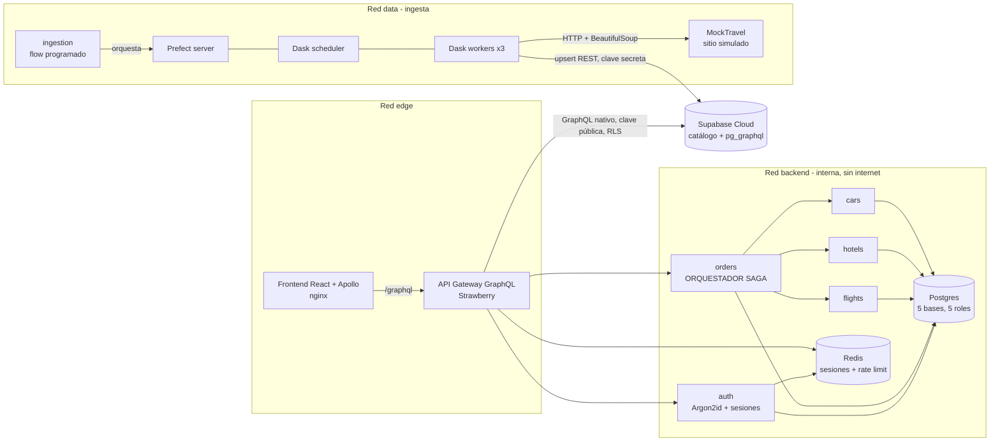
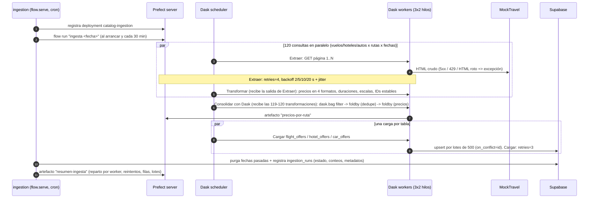
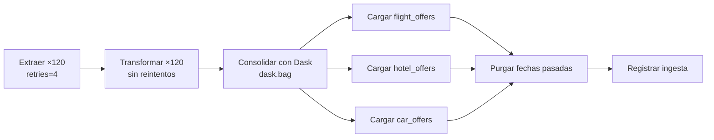
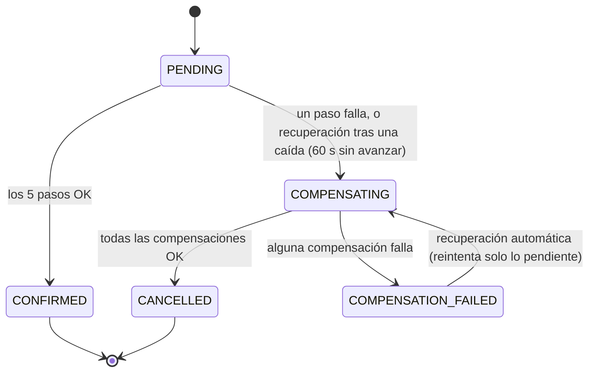
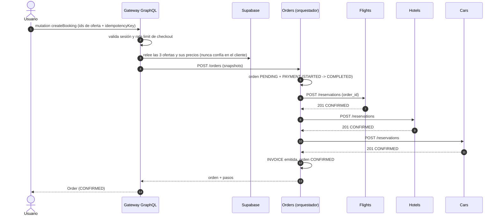
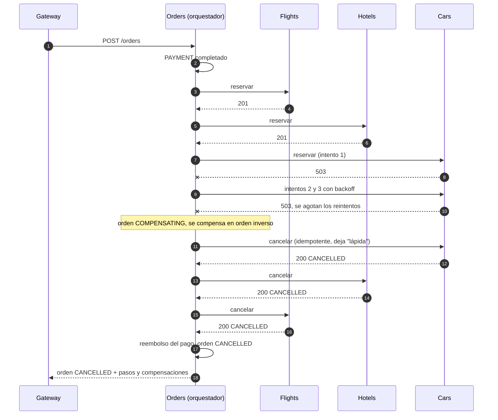

# Documento técnico de arquitectura — WanderSync

> Los diagramas están en **Mermaid** (se renderizan en GitHub, GitLab, VS Code con la extensión *Markdown Preview Mermaid* y mermaid.live).

## 1. Vista general

**Dos planos de datos separados a propósito**

| Plano | Dónde | Contenido | Acceso |
|---|---|---|---|
| Catálogo | Supabase Cloud | ofertas scrapeadas (vuelos, hoteles, autos) y bitácora de ingestas | escribe la ingesta (clave secreta); lee el gateway (clave pública, solo `SELECT`, RLS) |
| Transaccional | Postgres propio, una base por servicio | reservas, órdenes, bitácora SAGA, pagos, facturas, usuarios | solo su microservicio, con su propio rol |

Así las compensaciones de la SAGA nunca compiten con las actualizaciones masivas del catálogo, y un catálogo comprometido no toca dinero ni identidades.

## 2. Ingesta distribuida (Prefect + Dask)

- **El grafo que dibuja Prefect es el pipeline:** cada etapa recibe la salida de la anterior (no son tareas sueltas), así que la UI muestra las flechas Extraer → Transformar → Consolidar → Cargar → Purgar → Registrar. Una extracción que agota sus reintentos deja sin ejecutar su transformación y la ingesta termina `PARTIAL`, con el resto cargado.
- **Reintentos según la naturaleza del fallo:** la red y la fuente fallan de forma transitoria (Extraer: 4 reintentos con backoff; Cargar en Supabase: 3), el parseo es determinista (Transformar no reintenta: reintentarlo daría el mismo resultado).
- **Dask más allá del task runner:** la consolidación usa `dask.bag` sobre el cluster (`get_dask_client`): filtra filas inválidas, deduplica por id entre consultas (`foldby`) y calcula mínimo/promedio/máximo por ruta y ciudad (`foldby` con combinación entre particiones), estilo MapReduce.
- **Menos presión sobre la persistencia:** en vez de un upsert por consulta (~120 escrituras), se carga una vez por tabla en lotes de 500 (~6 peticiones), el cuello de botella que describe el enunciado.

- **Idempotencia:** los IDs son hash de la clave natural (aerolínea+vuelo+ruta+fecha…). Reintentar una tarea o re-ejecutar el flow solo actualiza precios y `scraped_at`.
- **Observabilidad:** nombres legibles (`ingesta 2026-10-03 16:28 UTC`, `Extraer vuelos BOG→CTG 2026-10-24`), logs por tarea con el worker de Dask y el número de intento, y dos artefactos por ejecución: `resumen-ingesta` y `precios-por-ruta`.
- **Una sola imagen** para Prefect, scheduler, workers y runner → mismas versiones de Python/dask/distributed en todo el cluster (requisito de Dask).
- **Fallos controlados:** MockTravel inyecta latencia y errores 500/503/429 (configurable en caliente en `:8090`).

## 3. SAGA de reserva (orquestación)

Elegí **orquestación** (no coreografía): el flujo completo vive en `services/orders/app/saga.py`, un motor puro y testeado (8 tests) separado de HTTP y SQL.

| # | Paso | Servicio | Compensación (orden inverso) |
|---|---|---|---|
| 1 | `PAYMENT` débito de la **billetera** del usuario | orders (local) | reembolso a la billetera |
| 2 | `FLIGHT` reserva de vuelo | flights | cancelar reserva |
| 3 | `HOTEL` reserva de hotel | hotels | cancelar reserva |
| 4 | `CAR` reserva de auto | cars | cancelar reserva |
| 5 | `INVOICE` factura | orders (local) | anular factura |

### Billetera del usuario (el dinero que mueve la SAGA)

Cada usuario recibe una billetera de **US$ 5.000** al registrarse (`wallets` en `orders_db`). El paso `PAYMENT` la **debita** y su compensación la **reembolsa**; todo queda en un libro mayor de solo-agregar (`wallet_movements`: apertura, débito, reembolso, ajuste, con el saldo resultante).

| Garantía | Cómo |
|---|---|
| No se gasta dos veces el mismo saldo | El débito es **un UPDATE condicional**: `SET balance = balance - x WHERE balance >= x RETURNING balance`. Comprobar y restar es atómico: 0 filas ⇒ saldo insuficiente, aunque dos reservas compitan |
| Ni débito ni reembolso dos veces | `UNIQUE(order_id, kind)` en el libro mayor + estado del pago (`CAPTURED`/`REFUNDED`): reintentos y recuperaciones no mueven dinero de más |
| Atomicidad | Saldo, movimiento y pago se confirman en **una** transacción (o no se confirma nada) |
| Validación de saldo | **Dos capas**: antes de crear la orden (`409 insufficient_funds` → `INSUFFICIENT_FUNDS` en GraphQL, sin orden creada) y de nuevo dentro del `PAYMENT` (paso definitivo, sin reintentos) |
| Visible en la demo | Chip de saldo en la cabecera, panel "Tu billetera" en vivo durante la SAGA (−débito / +reembolso), montos en los pasos de la línea de tiempo y libro mayor en *Mis reservas* |

### Máquina de estados de la orden

`failure_reason` guarda la **primera** causa (p. ej. `CAR: HTTP 503 tras 3 intentos`): las pasadas de recuperación no la reemplazan, solo la ponen si la SAGA se cortó por una caída y aún no tenía motivo.

### Camino feliz

### Fallo en el auto y compensación

### Reglas del orquestador (todas con test)

1. **Write-ahead:** cada paso se persiste como `STARTED` *antes* de ejecutarse (`saga_steps`). Si el proceso muere, se sabe qué pudo quedar hecho.
2. **Se compensa también el paso que falló** (su resultado puede ser incierto: timeout, respuesta perdida). Como toda compensación es idempotente, compensar de más es seguro.
3. **Lápida:** cancelar una reserva que no existe crea un registro `CANCELLED`; si la reserva original llega tarde, el servicio responde `409` y no queda huérfana.
4. **Idempotencia extremo a extremo:** `idempotencyKey` (doble clic / reintento del cliente) → misma orden; `order_id` único en cada servicio → un mismo request no duplica reservas.
5. **Reintentos solo ante fallos transitorios** (red, 5xx, 429), 3 intentos con backoff exponencial. Un 4xx es definitivo.
6. **Compensación fallida no se pierde:** la orden queda `COMPENSATION_FAILED`, las demás compensaciones continúan, y un bucle de recuperación (cada 30 s y al arrancar) reintenta solo lo pendiente. Ante un crash del orquestador se hace *backward recovery*: se compensa lo iniciado. **Seguro con varias réplicas:** solo se recupera lo que lleva 60 s sin avanzar (una SAGA viva actualiza `updated_at` en cada paso, cuyo peor caso es ~25 s), y cada orden la **reclama atómicamente** una sola réplica (`UPDATE … WHERE updated_at < corte`, `rowcount = 1`), así dos réplicas nunca compensan la misma orden a la vez.
7. **Respuesta con espera acotada:** la SAGA corre como tarea en segundo plano y `POST /orders` espera su final como máximo `SAGA_SYNC_WAIT_SECONDS` (10 s). Lo normal (incluidos los fallos simulados) es terminar antes y responder el estado final (201). Si un participante está colgado, se responde `202` con la orden `PENDING`, la SAGA continúa y el frontend consulta `order(id)` hasta un estado final. Así la SAGA nunca choca con los timeouts de 30 s de nginx/gateway. Al apagar, el servicio da 8 s de gracia a las SAGAs en curso; lo que no termine lo compensa la recuperación (regla 6).
8. **Observabilidad en Prefect (Prefect observa, no orquesta):** cada SAGA se refleja como un flow run `SAGA reserva <orden>` con una task run por paso y flechas `despues_de` (orden de ejecución) y `revierte` (cada compensación apunta al paso que deshace). El orquestador sigue siendo `SagaEngine` y la base es la fuente de verdad: `MirroredRepo` guarda cada paso y *después* encola el evento; un worker lo envía a la API REST de Prefect reintentando 408/429/502/503. Si Prefect no está disponible solo se pierde la visualización: **una reserva nunca falla por la observabilidad** (con test). Una recuperación tras reiniciar `orders` aparece como `SAGA recuperación <orden>`.
9. **El precio nunca lo dicta el cliente:** el gateway relee ofertas en Supabase y valida coherencia (mismo destino, misma fecha, misma moneda) antes de crear la orden.

## 4. API Gateway GraphQL

- **Un único esquema público** que agrega: catálogo (Supabase), identidad (auth) y reservas (orders). El frontend solo habla con `/graphql`.
- **Supabase por su GraphQL nativo (`pg_graphql`)**, con la clave pública y RLS. Las columnas que se piden a Supabase salen del árbol de campos que el cliente seleccionó (lista blanca): **sin over-fetching** también en la capa de datos.
- **Sin over-fetching demostrable:** con `GRAPHIQL=true` (o `SUPABASE_QUERY_TRACE=true`) cada respuesta trae en `extensions.supabase` la consulta **literal** enviada a Supabase, sus tablas y columnas. Al quitar un campo en GraphiQL, su columna desaparece de esa consulta. Siempre se piden además las columnas mínimas para calcular (`id`, precios, `currency`, `nights`). En producción la traza se apaga.
- **Sin N+1:** `packages` resuelve vuelos, hoteles y autos en *una* petición GraphQL a Supabase (alias) y compone paquetes en memoria (`packages.py`, con variedad garantizada). Hacia `orders`, la bitácora de la SAGA solo se pide si el cliente seleccionó `steps` (también dentro de fragmentos), y listar órdenes cuesta un número constante de consultas SQL (órdenes, facturas y pasos en lote), sin importar cuántas sean.
- **¿Por qué la búsqueda no pasa por los microservicios de Vuelos/Hoteles/Autos?** El enunciado (§3.3) define la base alimentada por Dask como *la fuente unificada de datos consumida por la capa de API Gateway*. Por eso el catálogo (lectura masiva, pública, de solo consulta) se lee directo de Supabase, mientras que Vuelos, Hoteles y Autos son dueños del **estado transaccional** de sus reservas, que es lo que la SAGA coordina. Pasar la búsqueda por ellos añadiría tres saltos de red y acoplaría la lectura del catálogo a servicios que no son dueños de ese dato (CQRS: lectura y escritura separadas).
- **Consultas:** `catalogStatus`, `packages`, `flightOffers`, `hotelOffers`, `carOffers`, `me`, `myOrders`, `order`, `wallet`. **Mutaciones:** `register`, `login`, `logout`, `createBooking`, `demoSetWalletBalance`.
- **Dos formas de reservar, una sola SAGA:** el paquete armado por el gateway (`packages`) o el viaje que arma el usuario fase a fase (`flightOffers` → `hotelOffers`/`carOffers` en el destino y la fecha del vuelo). Ambas terminan en `createBooking` con los tres ids, así que la validación (mismo destino, misma fecha, misma moneda, precios releídos de Supabase) y la SAGA son las mismas. El viaje armado añade `carPickupTime` (HH:MM), que el gateway valida (formato y no antes del aterrizaje del vuelo elegido) y guarda en el detalle del auto de la orden.
- Límite de profundidad, errores inesperados enmascarados, introspección/GraphiQL desactivables, queries por GET deshabilitadas.

## 5. Decisiones de diseño (ADR resumidas)

| Decisión | Alternativa | Por qué |
|---|---|---|
| Fuente scrapeada propia (MockTravel) | Booking/Amadeus/Google Flights/Kayak | Las APIs oficiales exigen alianza/aprobación o fueron retiradas; scrapear buscadores reales exige navegador headless y proxies (frágil, riesgo legal). El enunciado permite mocks. |
| Ingesta por REST de Supabase | Conexión Postgres directa | HTTPS/IPv4 desde cualquier red, solo URL+clave. Upsert idempotente con `on_conflict`. |
| Gateway BFF con Strawberry | Apollo Federation | 2 semanas: mismo resultado para el cliente con mucha menos infraestructura. |
| Catálogo leído directo de Supabase por el gateway | Búsqueda vía servicios Vuelos/Hoteles/Autos | §3.3 del enunciado: la base de Dask es la fuente unificada del gateway. Lectura (catálogo) y escritura (reservas) separadas; menos saltos y menos acoplamiento. |
| SAGA orquestada por HTTP | Coreografía con RabbitMQ | Flujo legible en un punto, demo determinista, sin broker extra. |
| Pago como primer paso | Pago al final | Muestra la compensación más rica (reembolso + 3 cancelaciones). |
| Un Postgres con 5 bases/roles | 5 instancias | Aísla credenciales y datos sin 5 contenedores; documentado como compromiso. |
| Sesiones server-side (Redis) | JWT | Revocables al instante, y permiten rotar el id en el login (session fixation). |

## 6. Trazabilidad con la rúbrica

| Criterio | Dónde está |
|---|---|
| Arquitectura y Docker (15%) | `docker-compose.yml` (14 servicios, 3 redes, healthchecks, `depends_on`), un `Dockerfile` por servicio |
| Gateway GraphQL y persistencia (15%) | `services/gateway/`, `supabase/schema.sql`, bases por servicio en `infra/postgres/` |
| SAGA (25%) | `services/orders/app/saga.py`, `actions.py`, `main.py`; participantes en `services/{flights,hotels,cars}`; §3 |
| Dask + Prefect (25%) | `services/ingestion/ingestion/flows.py`, `docker-compose.yml` (scheduler, workers, Prefect), §2 |
| Seguridad (20%) | `docs/SEGURIDAD.md`, `services/auth`, `services/gateway`, `scripts/audit.sh`, `scripts/security_checks.py` |
